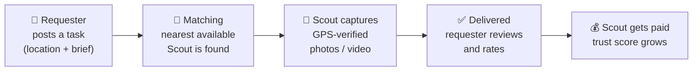

<div align="center">

# GroundLens

### Real photos from any location, on demand.

A two-sided marketplace that connects people who need proof of what's happening at a place with verified local **Scouts** who capture it, GPS-tagged and in real time.

[](https://groundlens-d81fe.web.app)


</div>

---

## Table of Contents

- [About](#about)
- [Key Features](#key-features)
- [How It Works](#how-it-works)
- [Who It's For](#who-its-for)
- [Tech Stack](#tech-stack)
- [Project Structure](#project-structure)
- [Getting Started](#getting-started)
- [Roadmap](#roadmap)
- [Author](#author)

---

## About

**The problem:** When you need to know what a place looks like *right now* (a property before you rent it, a delivery drop-off, a shop front, a site's construction progress), your options are outdated map imagery, a stranger's word, or travelling there yourself.

**The solution:** GroundLens lets anyone post a location-based request and have a nearby, verified Scout capture fresh photos or video on the spot. Every capture is tied to live GPS coordinates, so the requester knows the media is real, recent and from the right place, and the Scout gets paid for their time.

---

## Key Features

| Feature | Description |
|---|---|
| 📍 **Location-Based Matching** | Requests are matched with the nearest available Scouts to the target location. |
| 📸 **Verified Media Capture** | Captures record the target location and the Scout's live GPS position, so the proof can be trusted. |
| 🛡️ **Trust Score System** | Scouts build a reputation score from completed, verified tasks. |
| ⭐ **Ratings & Reviews** | Requesters rate each delivery, keeping quality high across the network. |
| 🔔 **Real-Time Notifications** | Both sides are kept updated as a task moves from posted to delivered. |
| 💳 **Secure Wallet** | Scouts track their earnings, and requesters manage payments in one place. |
| 🎯 **Two Dashboards** | A **Requester** view to post and track tasks, and a **Scout** command center with a radar of nearby tasks. |
| 🤖 **AI Assistant** | A built-in guide answers questions about posting tasks, pricing and becoming a Scout. |
| 📱 **Installable Web App** | Can be added to the home screen for an app-like experience. |

---

## How It Works



1. **Request:** pick a location on the map and describe what you need to see.
2. **Match:** GroundLens finds the nearest available Scout.
3. **Capture:** the Scout goes on site and captures media, locked to their live GPS position.
4. **Deliver:** you receive verified, time-stamped media and rate the job.

---

## Who It's For

- **Real estate:** check a property or neighbourhood before visiting or renting
- **Logistics and e-commerce:** confirm deliveries and drop-off conditions
- **Insurance:** get on-the-ground evidence for claims
- **Construction:** track site progress remotely
- **Retail and brands:** audit shop displays and outlets
- **Scouts:** earn money by completing tasks near you

---

## Tech Stack

| Layer | Technology |
|---|---|
| **Frontend** | HTML5, CSS3, vanilla JavaScript (ES modules) |
| **Animation** | [Motion](https://motion.dev) for scroll and entrance animations |
| **Icons** | Font Awesome 6 |
| **Browser APIs** | Geolocation API for live GPS capture |
| **Hosting** | Firebase Hosting |

---

## Project Structure

```
GroundLens/
├── index.html      # Landing page, requester and scout dashboards
├── styles.css      # Design system, layout and responsive styles
└── app.js          # Navigation, dashboards, task flow, GPS capture, AI assistant
```

---

## Getting Started

**Prerequisites:** a modern browser and [Node.js](https://nodejs.org) (only for the local server).

```bash
# 1. Clone the repository
git clone https://github.com/dhruvagrawal514-boop/GroundLens.git
cd GroundLens

# 2. Start a local server
npx serve .
```

Then open the URL it prints (usually `http://localhost:3000`).

> A local server is needed because `app.js` is loaded as an ES module.

---

## Roadmap

- [x] Landing page with how-it-works, industries and network sections
- [x] Requester and Scout dashboards
- [x] GPS-tagged capture flow
- [x] AI assistant
- [ ] Backend with real user accounts and task storage
- [ ] Live payments and Scout payouts
- [ ] Image tamper detection and EXIF verification
- [ ] Native Android app for Scouts

---

## Author

**Dhruv Agrawal**

[](https://www.linkedin.com/in/dhruv-agrawal-0b8a46204)
[](https://github.com/dhruvagrawal514-boop)
[](mailto:dhruvagrawal514@gmail.com)

<div align="center">

If you like this project, consider giving it a ⭐

</div>
