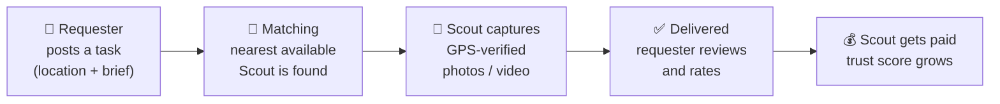

<div align="center">

# GroundLens

### Real photos from any location, on demand.

A two-sided marketplace that connects people who need proof of what's happening at a place with verified local **Scouts** who capture it, GPS-tagged and in real time.

[](https://groundlens-d81fe.web.app)


[](https://github.com/dhruvagrawal514-boop/GroundLens/actions/workflows/ci.yml)


</div>

---

## About

**The problem:** When you need to know what a place looks like *right now* (a property before you rent it, a delivery drop-off, a shop front, a site's construction progress), your options are outdated map imagery, a stranger's word, or travelling there yourself.

**The solution:** GroundLens lets anyone post a location-based request and have a nearby, verified Scout capture fresh photos or video on the spot. Every capture is tied to live GPS coordinates, so the requester knows the media is real, recent and from the right place, and the Scout gets paid for their time.

---

## Features

| Feature | Description |
|---|---|
| 🎯 **Two dashboards** | A **Requester** dashboard to post and track tasks, and a **Scout** dashboard with a radar of nearby tasks to accept. |
| 📝 **Task posting** | Requesters set a target, brief, media type (photo / video), bounty and deadline, with form validation. |
| 🔔 **Notifications** | Unread badge, mark one or all as read. |
| 💳 **Wallet & analytics** | Balance, transaction history and activity charts. |
| 📱 **Responsive** | Full layout on desktop; bottom tab bar and compact nav on mobile. |
| ✅ **Tested** | Playwright end-to-end tests run on desktop and mobile viewports in CI. |

> **Status:** the UI runs on mock data. The Supabase client is set up (`src/lib/supabase.js`) and switches on once the environment variables are set; wiring auth and tasks to it is the next milestone (see the roadmap).

---

## How It Works



1. **Request:** pick a location on the map and describe what you need to see.
2. **Match:** GroundLens finds the nearest available Scout.
3. **Capture:** the Scout goes on site and captures media, locked to their live GPS position.
4. **Deliver:** you receive verified, time-stamped media and rate the job.

---

## Who It's For

- **Real estate:** check a property or neighbourhood before visiting or renting
- **Logistics and e-commerce:** confirm deliveries and drop-off conditions
- **Insurance:** get on-the-ground evidence for claims
- **Construction:** track site progress remotely
- **Retail and brands:** audit shop displays and outlets
- **Scouts:** earn money by completing tasks near you

---

## Tech Stack

| Layer | Technology |
|---|---|
| **Frontend** | HTML, CSS, vanilla JavaScript (ES modules) |
| **Build** | [Vite](https://vitejs.dev) |
| **Animation** | [Motion](https://motion.dev) |
| **Backend** | [Supabase](https://supabase.com) (auth + Postgres) |
| **Testing** | [Playwright](https://playwright.dev), GitHub Actions |
| **Hosting** | Firebase Hosting |

---

## Project Structure

```
GroundLens/
├── index.html                 # App shell: top nav + view container
├── src/
│   ├── main.js                # Entry point: routing, nav, auth forms
│   ├── state.js               # Shared app state (current user, role, view)
│   ├── data/mock.js           # Placeholder data until Supabase is wired up
│   ├── lib/
│   │   ├── supabase.js        # Supabase client (null when env vars are unset)
│   │   ├── notify.js          # Toast notifications
│   │   ├── animate-number.js  # Count-up animation for stats
│   │   ├── home-animations.js # Landing page scroll animations
│   │   └── escape-html.js     # Escapes user input before rendering
│   ├── views/
│   │   ├── dashboard.js       # Requester dashboard and its tabs
│   │   └── scout-dashboard.js # Scout radar and task panel
│   ├── templates/             # HTML for each top-level view
│   └── styles/
│       ├── main.css           # Design system and components
│       └── layout.css         # Navigation and responsive layout
├── tests/e2e/                 # Playwright tests
└── .github/workflows/ci.yml   # Build + test on every push and PR
```

---

## Getting Started

**Prerequisites:** [Node.js](https://nodejs.org) 20+

```bash
git clone https://github.com/dhruvagrawal514-boop/GroundLens.git
cd GroundLens
npm install

# Optional: connect Supabase
cp .env.example .env   # then fill in your project URL and anon key

npm run dev            # http://localhost:5173
```

| Script | What it does |
|---|---|
| `npm run dev` | Start the dev server with hot reload |
| `npm run build` | Production build into `dist/` |
| `npm run preview` | Serve the production build on port 4173 |
| `npm run test:e2e` | Run the Playwright tests (builds and serves automatically) |

First time running tests: `npx playwright install chromium`.

---

## Roadmap

- [x] Landing page with how-it-works, trust and testimonial sections
- [x] Requester and Scout dashboards
- [x] Modular Vite codebase with end-to-end tests and CI
- [ ] Supabase auth (email + Google) and persisted tasks
- [ ] GPS-tagged capture flow for Scouts
- [ ] Live payments and Scout payouts
- [ ] Image tamper detection and EXIF verification

---

## Author

**Dhruv Agrawal**

[](https://www.linkedin.com/in/dhruv-agrawal-0b8a46204)
[](https://github.com/dhruvagrawal514-boop)
[](mailto:dhruvagrawal514@gmail.com)

<div align="center">

If you like this project, consider giving it a ⭐

</div>
